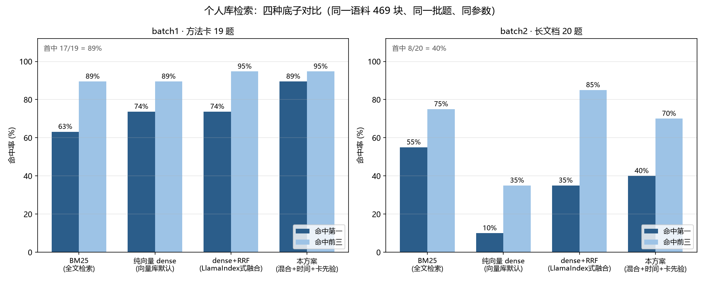
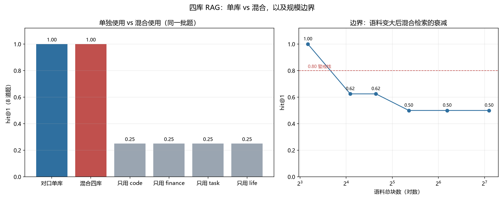

# decay-rag-lite — four corpora, one index each

**One algorithm, six languages, byte-identical output.** Plus a usage log that tells you whether retrieval actually helped.

同一算法、六种语言、逐字节一致。外加一份使用日志，回答「它到底帮上忙没有」。

> ## ⚠️ 开发者工具，不是开箱即用的知识库
>
> 这不是一个“上传文件就能问”的 AI 知识库产品。仓库里只有**检索层**：切块、块级时间戳、
> 字符 n-gram 向量、混合打分、时间衰减，加上三个命令行脚本（建库 / 查询 / 开工前自查）。
> 没有 UI、没有 PDF/Office 解析、没有数据库、没有 Agent、没有自动抓取。
>
> 想要产品级：看 LlamaIndex / LangChain / RAGFlow / Dify。
> 想要一个能读懂、能改、能嵌进自己项目里的 200 行核心：往下读。


A small personal RAG that keeps **code notes**, **finance notes**, **task state**
and **journals** in four separate indexes, so that a question about `docker build`
never gets answered with a line from your diary.

It is the runtime companion to [decay-rag](../decay-rag): same time-decay idea,
but organised around multiple corpora instead of one flat folder.

```
code     →  index_code_bge       toolchain, pitfalls, conventions
finance  →  index_finance_bge    factors, backtests, market logic
task     →  index_task_bge       status, hand-offs, environment
life     →  index_life_bge       journals, chats
```

## Scope: one person, one vertical domain

This is **not** a general-purpose RAG, and the numbers below should be read that
way — one person's vertical knowledge base, a few hundred to a few thousand
blocks, one machine, no server.

What that positioning implies, concretely:

- **Corpus size**: measured flat from 469 to 2500 blocks (`17/19` at every size),
  93 → 85 ms per query. Brute-force cosine is fine; no ANN, no vector DB.
- **What it is good at**: note-sized blocks — decisions, pitfalls, runbooks,
  cards. `89%` first hit on the 19 card questions versus `63–74%` for keyword and
  dense baselines.
- **What it is not good at**: long prose. On 20 long-document questions it scores
  `40%` first hit / `70%` top-3, behind BM25 (`55%`) and behind RRF top-3 (`85%`).
- **Who it is not for**: teams, multi-tenant search, documents you have never
  read, or anything where "the answer is somewhere in these 200 PDFs". Use a real
  search stack for that.

The design follows from the scope, not the other way round: four corpora because
one person has four kinds of notes; block-level timestamps because a personal
note gets superseded rather than deleted; no reranker because a reranker never
paid for itself here (17/19 → 16/19).
## Quick start

```bash
cp config.example.json config.json     # edit the paths, or keep the samples
python build.py --corpus code          # one index per corpus
python build.py --corpus finance
python build.py --corpus task
python build.py --corpus life

python ask.py --corpus finance "turnover vs fitness"
python preflight.py "docker build fails"          # code + finance + task
python preflight.py "what did I write" --with-life
```

Embeddings default to `bge-m3` through a local Ollama instance
(`http://127.0.0.1:11434`). If you do not want a model, build with
`--model local --suffix _loc` and pass `--model local --suffix _loc` to the
queries — the fallback is a 4096-dim hashed character n-gram, no dependencies.

## Personal library: how much of it is actually retrievable

Four baselines that production RAG stacks are built on, run over the **same 469
blocks**, the **same questions**, the **same parameters** (`decay 30`, card bonus
`0.03`). Nothing here downloads a framework: these are the components those
frameworks wrap (Elasticsearch-style BM25, a plain vector store, LlamaIndex-style
RRF fusion), so the numbers are comparable rather than marketing.



| corpus of questions | BM25 | dense | dense+RRF | this project |
|---|---|---|---|---|
| batch1 — 19 note-sized cards | 63% / 89% | 74% / 89% | 74% / 95% | **89% / 95%** |
| batch2 — 20 long documents | **55% / 75%** | 10% / 35% | 35% / **85%** | 40% / 70% |

(hit@1 / hit@3)

What the table actually says — please read it before the pitch:

- **On note-sized blocks this wins.** 89% first hit against 63–74% for the
  keyword and dense baselines. The 0.28 literal term is what earns it: personal
  notes are full of the exact words you will search for.
- **On long documents it does not.** BM25 beats it on first hit (55% vs 40%) and
  RRF beats it on hit@3 (85% vs 70%). Long documents have many plausible
  paragraphs; a 700-character chunk of prose does not contain the question.
- **Pure dense is the worst choice for a personal library** (10% / 35% on long
  documents). If you only adopt one line of this README: do not build a personal
  knowledge base on embeddings alone.
- **No configuration wins both corpora.** If your notes are card-like, use this.
  If they are long essays, run BM25 — or take the top-3 of an RRF fusion and
  read them.

Reproduce: `bench/personal_vs_vendor.json` holds the raw counts; the figure is
`docs/personal_vs_vendor.png`.
## What "preflight" does

`preflight.py` is the entry point you actually run before starting a task:

1. search `code`, `finance`, `task` at once (`life` excluded by default);
2. if a **method card** is clearly on point (similarity ≥ 0.62), narrow the
   answer to cards only — a card is a distilled conclusion, a raw document is
   evidence;
3. if the question is about **current state** (contains words like 接下来 /
   下一步 / 状态 / 待办 / 进度), promote the `task` index to the top;
4. otherwise return the best blocks with a `[1·code]`-style corpus tag.

Ranking inside every step:

```
sim   = 0.72 * cosine + 0.28 * literal bigram overlap
decay = 0.5 ** (age_days / 30)
final = 0.75 * sim + 0.25 * decay
```

## Benchmark: single corpus vs mixed, and where it breaks

`bench/compare.py` asks the same 8 labelled questions in three ways:

| 条件 | hit@1 |
|---|---|
| 只查对口库（oracle routing） | **1.00** |
| 混合四库（实际用法） | **1.00** |
| 只用 code 库答全部题 | 0.25 |
| 只用 finance 库答全部题 | 0.25 |
| 只用 task 库答全部题 | 0.25 |
| 只用 life 库答全部题 | 0.25 |

Two conclusions, one of them uncomfortable:

- **Mixing costs nothing here.** With 9 blocks the four corpora coexist without
  stealing each other's answers; routing is a convenience, not a necessity.
- **Wrong corpus costs 75 points.** Asking everything of one corpus lands at
  0.25 — the failure mode is not "slightly worse", it is "three questions out of
  four return the wrong document".

### The boundary

The sweep pads the pool with **keyword-stuffed decoys** — documents that repeat
the question's own words but are not the answer (the worst case, and a fair
model of a real corpus full of near-duplicates):

| 语料块数 | 9 | 17 | 25 | 41 | 73 | 137 |
|---|---|---|---|---|---|---|
| hit@1 | 1.00 | **0.62** | 0.62 | 0.50 | 0.50 | 0.50 |

**One decoy per question is enough to drop from 1.00 to 0.62.** The method has no
defence once a competing document contains the query's wording: cosine and bigram
overlap both reward surface similarity, and decay only reorders among near ties.

That is the honest boundary of this design: it is a *needle* retriever, not a
*semantic* one. It works when the answer is the only document phrased that way
(our 19-question holdout, 17/19). It degrades to coin-flip as soon as the corpus
contains paraphrases of the question.



## Files

| 文件 | 作用 |
|---|---|
| `corpora.py` | corpus registry, reads `config.json` |
| `build.py` | chunk + timestamp + embed, incremental |
| `ask.py` | single-corpus search with time decay |
| `preflight.py` | multi-corpus entry point (cards, state routing) |
| `bench/compare.py` | the benchmark above |
| `samples/` | four tiny fictional corpora so everything runs out of the box |

## License

Business Source License 1.1 — source is visible and free for personal, 
academic and internal non-commercial use; commercial use needs a license. 
Change Date: 2030-11-17, after which it becomes Apache-2.0. See [LICENSE](LICENSE).
